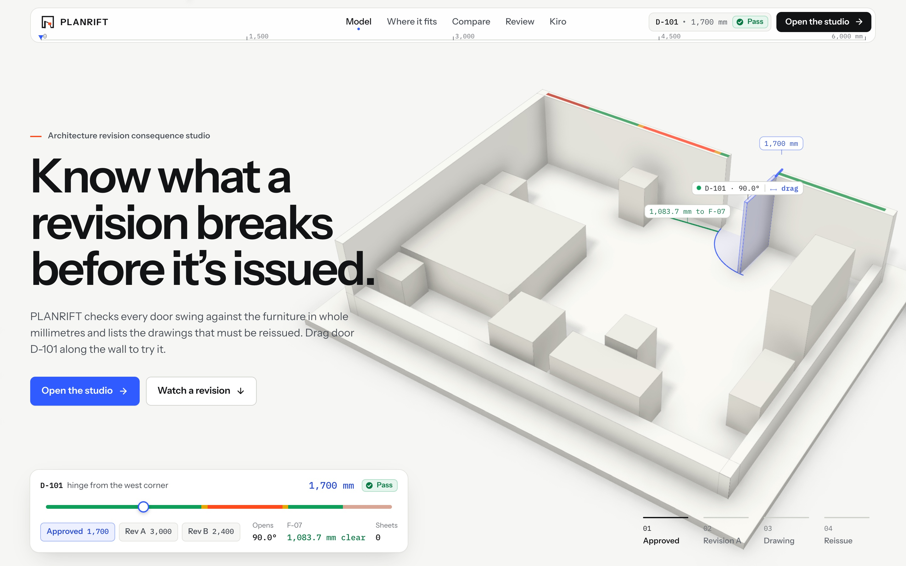
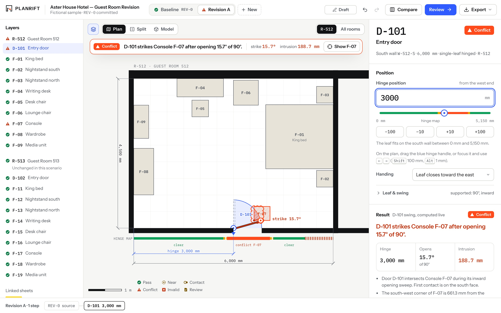

# PLANRIFT

**Architecture revision consequence studio.** Move a door in a hotel room, see what it hits, see which
drawings must be reissued, compare alternatives and record the decision, all before the revision is
issued. Built with [Kiro](https://kiro.dev) for Kiroween 2026 (Frankenstein category).

PLANRIFT is a rehearsal tool for simplified room geometry. It complements CAD and BIM tools; it does
not replace them.

**Live demo:** https://planrift-omega.vercel.app (landing) and https://planrift-omega.vercel.app/demo (studio). No sign-in.





## What it does

- **Computes, never fakes.** Door swings are checked against furniture in whole millimetres with exact
  integer predicates. Every status on screen comes from the engine in `src/domain/`.
- **One model, two views.** A WebGL "white model" and the SVG plan are built from the same scene, so they
  cannot disagree. Drag the door in either.
- **Shows the consequence.** Revision A (hinge at 3,000 mm) strikes console F-07 after 15.7° and
  intrudes 188.7 mm. Revision B (2,400 mm) clears it by 391.5 mm and still flags A-101, A-401 and D-01
  for human review.
- **Records the decision.** Branch a scenario, compare, accept or reject, export a receipt.

## What it does not claim

No code or accessibility compliance, no approval to build, no DWG/DXF/IFC/Revit support, no automatic
drawing edits. Rotated furniture, sliding doors and non-90° swings are reported as Unsupported.
See `docs/geometry/GEOMETRY_CONTRACT.md` for the exact model.

Submission material (screenshots, video script, Devpost text): `docs/submission/`.

## Run it

Node 22.13+ and npm.

```bash
npm ci
npm run dev        # http://localhost:3000  (landing)  and  /demo  (studio)
```

| Command               | Purpose                                                              |
| --------------------- | -------------------------------------------------------------------- |
| `npm run verify`      | typecheck, lint, unit tests, production build                        |
| `npm run e2e`         | Playwright judge flow and axe accessibility checks (desktop + phone) |
| `npm run test:domain` | geometry engine tests, including independent oracles                 |

First e2e run needs a browser: `npx playwright install --only-shell chromium`.

## Repository map

```
src/domain/      pure geometry + revision engine (no React, no browser APIs)
src/render/      render models derived from (scene, analysis)
src/components/  landing, studio, plan (SVG) and scene (WebGL white model)
tests/ e2e/      Vitest (domain, render) and Playwright
.kiro/           specs, steering, custom agents and hooks used to build it
docs/            master plan, geometry contract, status, evidence
```

## Built with Kiro

Five specs, nine steering files, seven custom agents and six hooks live in `.kiro/` and are listed on the
landing page (read from the folder at build time). Hooks gate task completion on typecheck, lint and
tests, re-run geometry tests on engine edits, block credentials in writes, and ask before any deploy or
push.

## Privacy

No analytics, cookies, remote fonts or third-party requests. Project state stays in your browser.
Imported files are treated as untrusted data and validated against a strict schema.

## Licence

MIT. The Aster House Hotel project is fictional.
